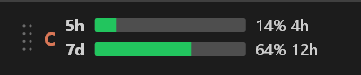
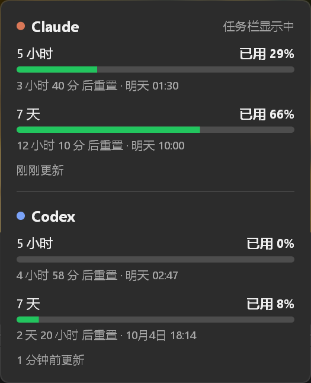

# IUsage

在 Windows 11 任务栏上直接显示 **Claude** 和 **Codex** 的用量，不用再打开网页查还剩多少额度。

**[⬇ 下载最新版（Windows x64）](../../releases)** · [快速开始](docs/QUICKSTART.md) · [隐私说明](PRIVACY.md) · [更新记录](CHANGELOG.md)

> 这是非官方工具，所用接口随时可能被官方改动而失效。

## 功能

- **任务栏进度条**：上面一条是 5 小时额度，下面一条是 7 天额度，右侧显示百分比和离重置还有多久（如 `13% 4h`）。
- **颜色提醒**：用到 75% 变黄，90% 变红。
- **低额度通知**：剩余 20%、10%、5% 时各弹一次系统通知。
- **详情面板**：点一下进度条，同时查看 Claude 和 Codex 的用量和精确重置时间。

- **一键切换**：点进度条左边的字母，`C` 是 Claude，`X` 是 Codex。
- **显示已用或剩余**：右键菜单里切换。
- **开机自启**：右键菜单里勾选。
- **小巧**：单个 exe，不到 500 KB，免安装，不需要额外运行库。
- **注重隐私**：只连接 Claude 和 OpenAI 的官方服务器，没有统计、上报或自动更新。

## 开始使用

1. **下载**：从 [Release 页面](../../releases) 下载 ZIP，解压到一个固定的本地文件夹（例如 `D:\Tools\IUsage\`）。不要放在 OneDrive 等同步文件夹里，也不要直接在压缩包里运行。
2. **运行**：双击 `IUsage.exe`。程序没有代码签名，Windows 可能提示“已保护你的电脑”，点 **更多信息 → 仍要运行** 即可；请不要为此关闭系统安全防护。
3. **登录**：
   - **Codex**：只要在这台电脑上登录过 Codex（客户端或命令行），就会自动读取，不用设置。
   - **Claude**：右键任务栏上的进度条，选 **Claude 登录设置…**，二选一：
     - **网页登录**：在浏览器登录 claude.ai 后取出 sessionKey 粘贴进去。设置窗口里的“如何获取？”有说明。
     - **Claude Code 登录**：如果装了 Claude Code 并登录过，点“改用本机 Claude Code 登录”即可。
   - 只登录 Claude 桌面客户端不行，读不到用量。
4. **可选**：右键勾选“开机自启”。

> sessionKey 相当于你的登录凭据，不要发给任何人。

## 日常操作

| 想做什么 | 怎么做 |
|---|---|
| 切换 Claude / Codex | 点进度条左边的字母 |
| 看详细用量 | 左键点进度条或托盘图标 |
| 移动位置 | 按住最左边的点阵手柄左右拖动 |
| 打开菜单 | 右键进度条或托盘图标 |
| 退出 | 右键菜单 → 退出 |

## 进度条上的状态

| 显示 | 意思 | 怎么办 |
|---|---|---|
| `…` | 正在获取数据 | 稍等 |
| 整体变暗 | 最近一次刷新失败，显示的是之前的数据 | 一般会自动恢复 |
| `未登录` | 没找到登录信息 | 按“开始使用”第 3 步登录 |
| `已过期` | 登录失效 | Claude 重新登录或更新 sessionKey；Codex 在 Codex 里重新登录 |
| `未订阅` | 账号没有付费额度，已停止刷新 | 续订后在详情面板点“已续订？点此重新检查” |
| `限流` | 请求太频繁，被服务器暂时拒绝 | 不用管，等几分钟会自动重试 |
| `离线` | 连不上网络 | 检查网络或代理 |

## 常见问题

**多久刷新一次？**
使用电脑时每 65 秒刷新一次；5 分钟没动键盘鼠标后改为 15 分钟一次，回来后立刻补上。这样可以避免被服务器限流。

**数据安全吗？**
登录信息只发往 Claude 和 OpenAI 的官方服务器。网页登录的 sessionKey 用 Windows 自带的加密保存在本机，不写入日志。详见 [隐私说明](PRIVACY.md)。

**怎么升级？**
退出旧版，用新的 `IUsage.exe` 覆盖旧文件，再重新运行。设置会保留。

**怎么卸载？**
先在右键菜单里取消“开机自启”，退出程序，删除 exe。如果还想清除设置，再删除 `%APPDATA%\IUsage\` 文件夹。

**能改变色阈值或刷新间隔吗？**
可以，编辑 `%APPDATA%\IUsage\settings.json` 后重启程序：`warn_pct`（变黄，默认 75）、`crit_pct`（变红，默认 90）、`poll_secs`（刷新间隔秒数，默认 65，最小 65）。

**支持 Mac 吗？**
有菜单栏版本，但没有签名和公证，目前需要自行构建，见 [macOS 说明](macos/README.md)。

## 问题反馈

遇到问题请提交 [Issue](../../issues)。安全问题请按 [安全反馈](SECURITY.md) 私下报告。

想了解实现原理或自己编译，请看 [技术说明](docs/TECHNICAL.md)。

## 致谢

任务栏嵌入的做法和样式参考了 [Tray-Usage-Monitor](https://github.com/Firnschnee/Tray-Usage-Monitor)，请求节奏和限流处理参考了 [usage-monitor-for-claude](https://github.com/jens-duttke/usage-monitor-for-claude)。两者都是 MIT 许可；本项目没有复制它们的代码。

## 许可

MIT，见 [LICENSE](LICENSE)。
